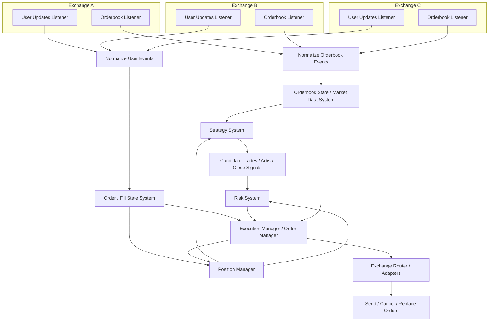
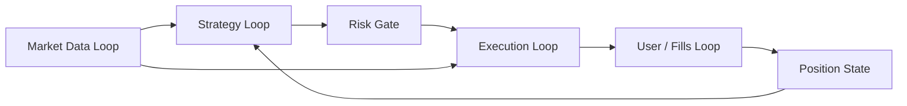

# Trading System Flow

This note captures the intended event flow for the prediction markets trading
system as it evolves from a paired Kalshi/Polymarket arbitrage bot into a more
general multi-exchange trading platform.

## High-Level Framework

For each exchange, run two listener types:

- An orderbook listener for public market data.
- A user updates listener for private order, fill, balance, and account events.

With three exchanges, this means six listeners total.



## Core Responsibilities

### Listener Layer

Listeners should be exchange-specific and thin. They connect to each exchange,
receive raw messages, and hand those messages to normalization code.

They should not contain strategy, risk, or portfolio logic.

### Normalization Layer

Normalize exchange-specific payloads into internal event types such as:

```text
OrderBookSnapshot
OrderBookDelta
TradePrint
OrderAck
OrderReject
CancelAck
Fill
BalanceUpdate
PositionUpdate
```

All normalized events should include enough metadata to trace the event:

```text
exchange
asset_id
market_id
timestamp
sequence_number
correlation_id
```

### Orderbook State / Market Data System

The orderbook system owns current market state. It should:

- Maintain local books from snapshots and deltas.
- Detect sequence gaps and stale books.
- Publish reliable best bid/ask and depth updates.
- Emit orderbook update events to strategy and execution systems.

### Strategy System

The strategy system decides what the bot wants to do.

It consumes:

- Orderbook state.
- Position state.
- Order/fill state where relevant.
- Strategy configuration.

It emits:

- Candidate arbitrage entries.
- Close signals.
- Cancel or replace signals.
- Hedge or rebalance intents.

The strategy should not place orders directly.

### Risk System

Risk gates every proposed action before execution. It should check:

- Book freshness.
- Expected edge after fees, spread, slippage, and latency.
- Available balances.
- Existing exposure.
- Open orders.
- Per-market, per-exchange, and per-strategy limits.
- Whether the trade conflicts with another strategy or active execution.

Risk emits approved or rejected execution plans.

### Execution Manager / Order Manager

Execution owns live order mechanics. It should:

- Convert approved plans into exchange orders.
- Send, cancel, and replace orders.
- Track order lifecycle.
- Handle retries, rejects, timeouts, partial fills, and one-sided fills.
- Use private user updates as the source of truth for order state.
- Emit execution events to position management and strategy.

Execution may also consume orderbook updates when it needs current top-of-book
state for cancel/replace, unwind, or close logic.

### Position Manager

The position manager owns portfolio truth. It should track:

- Open positions.
- Closed positions.
- Average entry/exit prices.
- Realized and unrealized PnL.
- Exposure by exchange, market, strategy, and asset.
- Active order-linked exposure.

The position manager should inform close decisions, not make them by itself.
Closing is a strategy decision, risk-approved and execution-managed.

## Important Boundary

Position manager should not decide when to close orders or positions. It should
tell the rest of the system what is true:

```text
We are long 100 YES at average price 0.42.
Current marked value is 0.47.
Open order exposure is 25.
Net market exposure is 125.
```

The strategy decides:

```text
Close this position now.
```

Risk decides:

```text
This close is allowed.
```

Execution decides:

```text
Send, cancel, replace, or retry these exchange orders.
```

## Mental Model

The system has three connected loops:



The production-grade design goal is a clean split between:

- Market state.
- Strategy decisions.
- Risk approval.
- Execution ownership.
- Position truth.

